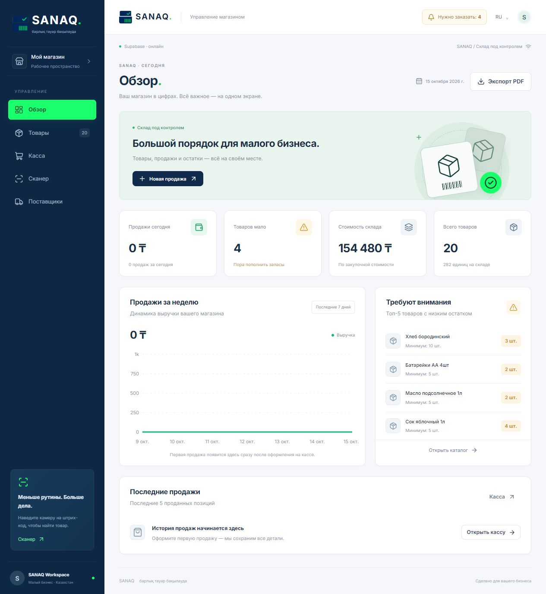

# SANAQ — барлық тауар бақылауда

  

**Live Demo: https://sanaq-eight.vercel.app**



PWA система учета для маленьких магазинов Казахстана. Заменяет Excel, работает со сканером штрих-кодов прямо с телефона.

## Что внутри (проверено тестами PASS)

- POS с атомарной функцией sanaq_apply(): защита от дублей, rollback при нехватке
- Realtime бейдж "Нужно заказать"
- Offline-first Dexie.js + очередь синхронизации
- Сканер html5-qrcode, импорт Excel, экспорт PDF, RU/KZ переключатель

## Стек

Vite + React 18 JS, Zustand, TanStack Query, Tailwind + shadcn, Supabase, PWA

## Быстрый старт

```sh
npm install
cp .env.example .env
# Вставь VITE_SUPABASE_URL и VITE_SUPABASE_ANON_KEY в .env
npm run dev
```

- SQL: выполни supabase.sql, затем supabase-upgrade.sql в SQL Editor Supabase
