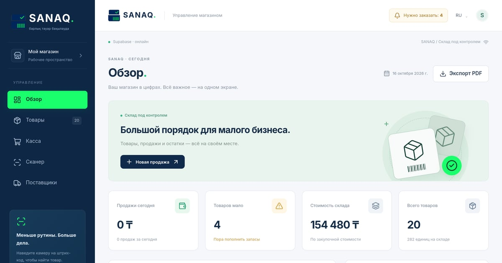

# 📦 SANAQ — барлық тауар бақылауда

[](https://react.dev)
[](https://supabase.com)
[](https://sanaq-eight.vercel.app)
[](https://sanaq-eight.vercel.app)

> 🏪 **PWA-система учёта для маленьких магазинов Казахстана.** Заменяет Excel: склад, касса, сканер штрих-кодов и поставщики — прямо с телефона, офлайн и с realtime-синхронизацией.

**🚀 Live Demo: https://sanaq-eight.vercel.app**



---

## 📖 О проекте / About

SANAQ — одностраничное PWA для владельцев маленького бизнеса в Казахстане: приложение ставится на домашний экран, работает без интернета (офлайн-очередь) и синхронизируется с Supabase, как только появляется сеть. Данные защищены атомарной SQL-функцией — никаких двойных списаний и гонок при одновременных продажах.

---

## 🧩 Что внутри / Features

| Возможность | Как работает |
|---|---|
| 💳 **POS с атомарной функцией** | `sanaq_apply()` в Postgres: одна транзакция = продажа + списание; защита от дублей, **rollback** при нехватке остатка |
| 🔔 **Realtime-бейдж** | «Нужно заказать: N» — Supabase Realtime подсвечивает товары с низким остатком в реальном времени |
| 📴 **Offline-first** | Dexie.js (IndexedDB) кэширует данные, очередь синхронизации отправляет продажи при восстановлении сети |
| 📷 **Сканер штрих-кодов** | html5-qrcode — камера телефона как сканер на кассе |
| 📊 **Excel / PDF** | Импорт позиций из Excel, экспорт отчётов в PDF в один клик |
| 🌐 **RU / KZ** | Переключатель языка интерфейса: русский и казахский |

✅ Покрыто тестами: `npm test` (node --test) + Playwright e2e.

---

## 🛠 Стек / Tech stack

| Слой | Выбор |
|---|---|
| Фронтенд | **Vite + React 18** (JS) |
| Состояние | **Zustand** |
| Серверные данные | **TanStack Query** |
| Стили | **Tailwind CSS + shadcn/ui** |
| Бэкенд | **Supabase** (Postgres, Realtime, Auth) |
| Офлайн | **Dexie.js** (IndexedDB) |
| PWA | Service worker + манифест (installable) |

---

## 🚀 Быстрый старт / Quick start

```bash
# Зависимости
npm install

# Переменные окружения
cp .env.example .env
# VITE_SUPABASE_URL=...
# VITE_SUPABASE_ANON_KEY=...

# Dev-сервер
npm run dev          # http://localhost:5173

# Тесты
npm test             # unit (node --test)
npm run test:e2e     # playwright e2e
```

База: выполни `supabase.sql`, затем `supabase-upgrade.sql` в SQL Editor Supabase.

---

## 🔐 Env / Environment

| Переменная | Описание |
|---|---|
| `VITE_SUPABASE_URL` | URL проекта Supabase |
| `VITE_SUPABASE_ANON_KEY` | Anon-ключ Supabase (публичный, безопасен в браузере) |

---

## ☁️ Деплой / Deployment

1. Репозиторий: [github.com/GangstaKZ/SANAQ](https://github.com/GangstaKZ/SANAQ)
2. Подключён к **Vercel** → автодеплой при каждом push в `main`
3. Прод: **https://sanaq-eight.vercel.app**

---

## 📁 Структура проекта / Project structure

```
├── src/
│   ├── api/          # Supabase-клиент, запросы
│   ├── components/   # UI (shadcn + свои)
│   ├── hooks/        # React-хуки (realtime, офлайн-очередь)
│   ├── lib/          # утилиты, константы
│   ├── pages/        # Обзор, Товары, Касса, Сканер...
│   └── store/        # Zustand-сторы
├── tests/            # unit (node --test) + e2e (playwright)
├── docs/images/      # preview.jpg для README
├── supabase.sql      # схема + функция sanaq_apply()
├── supabase-upgrade.sql
└── public/og.jpg     # OG-картинка
```

---

<div align="center">

 Made with 📦 in Kazakhstan · [SANAQ live demo](https://sanaq-eight.vercel.app)

</div>
